  
  
  
  
  



<a href="https://store.steampowered.com/app/1581500/Dragon_Drop/"></a>

  

<a href="https://ffvii-timeline-analyzer.vercel.app"></a>

  
  

<a href="https://github.com/ALLEXCEED360/OmniPlay"></a>

  

<a href="https://github.com/ALLEXCEED360/Before-You-Post"></a>

  

<a href="https://github.com/ALLEXCEED360/Echolens"></a>

  


  
  
  
  





  


  
  
  

<table>
<tr>
<td width="50%" align="center" valign="top">

</td>
<td width="50%" align="center" valign="top">

  

 

</td>
</tr>
</table>

<a href="https://metaphor-re-fantazio-portfolio.vercel.app"></a>

  
  

<a href="https://metaphor-re-fantazio-portfolio.vercel.app"></a>
